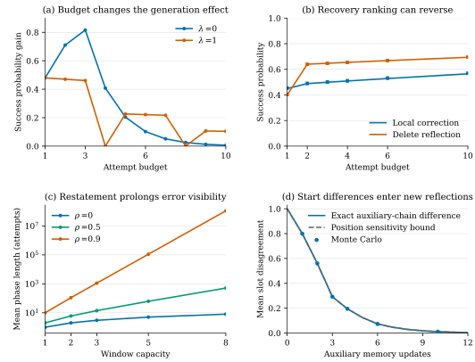
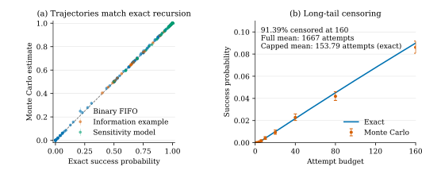

# 有限反思记忆仿真：预算、信息退出与恢复排序

更新：2026-10-23。三组受控仿真已完成，使用人工指定机制，连接[有限记忆命题](../research/finite_memory_recovery_analysis.md)与下一阶段的真实 Agent 校准。

最主要的结果是：**恢复效果取决于观察预算，删除条目还会改变其他信息的退出时间。** 逐步 Monte Carlo 与精确递推一致；在含正确说明和有效线索的机制扫描中，也出现了纠正与删除随预算交换排序的情形。

## 1. 运行与证据

源码、随机数、样本数和判断标准先于正式采样公开，冻结提交为 [`a79c4b3`](https://github.com/lixingyi701/theory/commit/a79c4b3bf62bb8eb11ff695e6bf98db769a075d3)。[协议](../../repro/theory-20261023/finite-memory-simulation-protocol.json)的 SHA-256 为 `e5ba409bd5e7495d174229b00a3ccf3959951e922347f6454a3cae04ca3bf422`。[设计文档](finite-memory-simulation-design.md)保留为采样前版本，当前进展以本报告为准。

| 部分 | 精确计算范围 | Monte Carlo 轨迹 |
|---|---|---:|
| 错误生成／重述与窗口移出 | 1125 个参数条件；完整二值 FIFO 与压缩状态；期望公式与分数线性方程 | 160000 |
| 正确说明、有效线索和条目位置 | 585 个窗口状态；九种机制、两个起点、五种操作，共 90 个条件 | 20000 |
| 起始差异的影响界 | 八个起点、64 个配对；成功概率和各槽位差异 | 80000 |

每个 Monte Carlo 起点均为十个固定种子、每种子 1000 条轨迹，最多 160 次尝试。三组在服务器用三个 CPU 进程并行，正式计算墙钟为 **8.73 秒**，不含实现、依赖安装和绘图。运行时 GPU 2、3 空闲；该规模的 NumPy PCG64 采样无需 GPU。GPU 0 的模型服务和 GPU 1 的其他任务保留。

各条件使用同一组种子，相同编号的轨迹共享对应随机数。区间与误差检查按每个起点的 10000 条记录计算；260000 是全部模拟记录数，不将跨条件共享随机数的记录作为一个独立样本池。

正式仿真使用 NumPy 1.26.4、float64，每进程一个 BLAS 线程。本轮新增 LLM 调用为零；Reflexion 账本仍为 12369 次请求、12369 份响应。完整[完成记录](../../repro/theory-20261023/finite-memory-simulation-completion.json)和[轨迹重算审计](../../repro/theory-20261023/finite-memory-simulation-audit.json)保存了来源与文件哈希。

## 2. 数值实现与精确参照是否一致

| 检查 | 结果 |
|---|---|
| 1125 个参数条件的完整窗口／压缩状态成功率 | 最大绝对差为 0 |
| 期望公式／独立分数线性方程 | 5400 个状态比较完全相等 |
| 一般窗口期望方程残差 | 最大约 $8.88\times10^{-15}$ |
| 260 项 Monte Carlo 成功概率 | 最大绝对差 0.011369；预设统一容差 0.023301 |
| 1920 项 Monte Carlo 槽位差异概率 | 最大绝对差 0.006600；该概率族容差 0.025356 |
| 精确成功率影响界／槽位影响界 | 最大超出量分别约 $8.33\times10^{-17}$、$1.11\times10^{-16}$，处于浮点舍入量级 |

两组 Monte Carlo 容差分别按 .01 的概率族误差水平固定；图和 JSON 另外给出成功概率的逐点 95% Wilson 区间。原始首次成功时间与位置差异计数已重新汇总，确认 260000 条记录、全部种子与全部比较数一致。

这些检查说明轨迹采样、窗口更新和数学参照一致；真实 Reflexion 是否符合对应状态假设，仍由下一阶段数据检验。



图 1：全部参数均为人工指定。(a) $W=3,p=.5,q=.02,\rho=0$ 的预算内成功概率增益；(b) 固定信息位置反例的精确结果及 Monte Carlo，误差线为逐点 95% Wilson 区间；(c) $q=0$ 时的平均含错阶段长度，纵轴为对数；(d) 两条辅助记忆链的槽位差异平均值及位置敏感度上界。辅助链用于分析更新机制，与按“连续失败”筛选后的真实样本分布不同。

## 3. 预算变化会改变错误生成概率的作用

记 $\Delta_b=V_b(0)-V_b(W)$，比较其他条件相同、不含目标错误与最新条目含目标错误的起点。取 $W=3,p=.5,q=.02,\rho=0$，精确递推得到：

| 不含错起点失败后生成错误的概率 | 三次预算增益 $\Delta_3$ | 六次预算增益 $\Delta_6$ |
|---|---:|---:|
| $\lambda=0$ | 0.816192 | 0.102024 |
| $\lambda=1$ | 0.460992 | 0.221368 |

提高 $\lambda$ 降低了三次预算的增益，却提高了六次预算的增益。有限窗口使两种起点获得成功机会的时间不同，因此不能把持续可见子模型的单调结论直接套用到有限记忆。

全网格还按 $(W,p,q,\rho)$ 分成 225 组，比较全部相邻 $\lambda$ 取值及 1 至 160 次预算。169 组至少存在一个预算，使 $\lambda$ 增大后的 $\Delta_b$ 更高。144000 次相邻参数／预算比较中，这类增加出现 66188 次。这里统计的是指定人工网格的形状，不是实际任务中的发生比例。完整结果见[二值窗口汇总](../../repro/theory-20261023/finite-memory-binary-results.json)。

平均尝试数与预算内增益也不能混为一谈。例如 $q=0,\rho=0,W=3$ 时，两种 $\lambda$ 端点的节省期望尝试数都为 3；预算内增益却有不同曲线。这与命题 1、命题 2 的结论一致。

## 4. 删除改变信息退出时间，可能改变恢复排序

### 固定反例：首次更好，不保证两次预算更好

起点为 $(H,E,N)$，$H$ 是有效线索，$E$ 是目标错误，$N$ 是实际存在、三个标记均为零的反思。局部纠正得到 $(H,C,N)$，删除则得到两条真实记忆 $(H,N)$。失败后总是新增 $N$，因此删除使原先的 $H$ 多保留一次尝试。

| 指标 | 局部纠正：精确值 | 局部纠正：Monte Carlo | 删除：精确值 | 删除：Monte Carlo |
|---|---:|---:|---:|---:|
| 一次预算成功率 | 0.4500 | 0.4537 | 0.4000 | 0.4047 |
| 两次预算成功率 | 0.4885 | 0.4896 | 0.6400 | 0.6388 |
| $\mathbb E[\min(\mathcal T,161)]$ | 26.0952 | 26.1733 | 18.8752 | 18.8946 |
| 完整期望尝试数（解析／线性方程） | 27.1250 | 未估计 | 19.6000 | 未估计 |

末行不从截断轨迹估计；两种均值使用不同定义。首次成功机会的优势来自纠正说明，随后排序反转来自有效线索的退出时间。

### 含随机反思更新的九种机制扫描

九种机制均共享同一组状态函数，恢复只改变起点。基准条件中，两个起点的局部纠正在所有检查预算上都不低于删除。扫描中有一个恢复比较出现排序反转：起点 $(H,E,N)$，将有效线索的一次成功增益 $d_H$ 从 .1 改为 .3，其余参考参数不变。

| 尝试预算 | 局部纠正成功概率 | 删除成功概率 | 纠正减删除 |
|---:|---:|---:|---:|
| 1 | 0.750000 | 0.700000 | +0.050000 |
| 2 | 0.877500 | 0.903700 | −0.026200 |
| 3 | 0.939055 | 0.946625 | −0.007570 |
| 4 | 0.969602 | 0.968633 | +0.000970 |

这里先是纠正更好，随后删除更好，到四次预算时纠正再次领先。完整期望尝试数分别为 1.50381 和 1.54134，平均意义下纠正仍更好。这一结果来自精确递推；本轮没有为九种扫描条件额外生成 Monte Carlo。

操作对照还分离了两种信息作用。在参考机制中：

- 对 $(H,E,N)$，删除与替换为真实 $N$ 的首次成功率相同，两次预算下删除高出 0.04；差异来自容量占用和较早线索的退出时间。
- 对 $(N,EH,N)$，只移除错误命题而保留同条有效线索，相比把整条替换为 $N$，首次成功率高出 0.10；差异来自同条线索保留。

因此“是否移除了错误”不足以描述恢复起点，还需要记录纠正说明、有效线索以及真实条目的顺序和数量。所有 90 个条件及对照见[信息与位置汇总](../../repro/theory-20261023/finite-memory-information-results.json)。

## 5. 新反思更新的敏感度决定起始影响如何延续

第三组使用已知成功敏感度 $\alpha=(.1,.1,.1)$ 和更新敏感度 $\beta=(.1,.1,.2)$。对全部 64 个起点配对，精确成功概率差与精确辅助链槽位差异都满足命题 3 的界；该仿射机制中，图示有序配对的槽位影响界接近等式。

两种边界也按精确联合转移单独计算：更新与原记忆无关时，辅助链中的起始差异在三次更新后消失；确定复制最新错误标记时，即使原始条目已经退出，两条链仍可持续不同。有限容量限制原条目的保留时间，但不会自动阻止其内容写入新反思。[影响界汇总](../../repro/theory-20261023/finite-memory-sensitivity-results.json)同时保留成功概率与辅助链结果。

## 6. 长尾决定有限预算记录能回答什么

取 $W=3,p=.5,q=0,\lambda=.5,\rho=.9$，从最新条目含错的状态开始。虽然该模型最终成功概率为 1，但 160 次预算后，10000 条轨迹仍有 **9139 条未成功**。

| 量 | 精确值 | Monte Carlo |
|---|---:|---:|
| 完整期望尝试数 $\mathbb E\mathcal T$ | 1667 | 未估计 |
| 截断量 $\mathbb E[\min(\mathcal T,161)]$ | 153.7932 | 154.0574 |
| 160 次后未成功的比例 | 由精确曲线给出 | 0.9139 |

这说明只延长少量重试，或只平均已成功轨迹，可能严重低估等待时间。真实 Agent 校准应优先使用与预算一致的成功概率和删失统计；只有在转移模型得到支持时，才用模型推导更长期的量。



图 2：(a) 260 个成功概率的精确值与 Monte Carlo，误差线为逐点 95% Wilson 区间；(b) 上述高重述概率条件的有限预算成功曲线。右图使用 0 至 0.11 的独立纵轴，展示该条件的低成功比例。

## 7. 下一阶段：按缺失机制校准真实 Agent

仿真阶段的交付已完成。真实校准围绕以下三个问题准备，不直接扩充全部记忆组合：

1. **分别估计错误生成与重述。** 按起始记忆是否含目标错误、任务条件和尝试序号分组，对失败后的新反思标注。已有 5/8 和 11/11 是开发记录计数，不直接当作通用 $\lambda,\rho$。
2. **区分纠正说明与有效信息。** 先从现有公开轨迹核验有效线索，再确定局部纠正、只移除目标错误、整条替换与整条删除中哪些对照确实能隔离所需机制。有效线索须有公开依据，含糊文本保留不明确标签。
3. **检查条目年龄与多步更新。** 记录每次失败后新反思的内容及窗口推进，检查同样含错但距退出时间不同的起点，是否有不同的成功与更新概率。新正式任务与重复种子分别承担任务迁移和任务内稳定性检查。

这些测量将决定二值压缩是否足够，还是必须使用正确说明、有效线索和条目年龄。识别后冻结共同机制参数，再预测新任务和预先留出的预算／恢复条件。当前四任务 ECC／CCE 继续作为开发资料，134 holdout 保持封存。

## 8. 复现与工件

核心文件为[机制与精确参照](../../scripts/finite_memory_models.py)、[执行器](../../scripts/run_finite_memory_simulation.py)、[轨迹审计与绘图](../../scripts/summarize_finite_memory_simulation.py)。原始种子分组记录、完整精确网格和位置计数保存在服务器 `runs/finite-memory-simulation-20261023/`；完成记录包含其文件哈希。

在同样的 NumPy 1.26.4 环境、冻结源码与设计文件下，用新目录复现：

```bash
OPENBLAS_NUM_THREADS=1 OMP_NUM_THREADS=1 MKL_NUM_THREADS=1 \
PYTHONPATH=src:scripts PYTHONNOUSERSITE=1 \
python scripts/run_finite_memory_simulation.py \
  --protocol repro/theory-20261023/finite-memory-simulation-protocol.json \
  --output runs/finite-memory-simulation-NEW \
  --source-commit a79c4b3bf62bb8eb11ff695e6bf98db769a075d3
```

用 `summarize_finite_memory_simulation.py --run <run> --protocol <protocol> --output-dir <new-export-dir>` 重算保存记录。绘图使用 `--render-only`，在独立依赖目录运行 Matplotlib 3.9.4；渲染环境的 NumPy 2.2.6 不参与正式采样。服务器未安装 Times New Roman，图中显式使用 DejaVu Serif，版本与输入哈希见[绘图凭据](../../repro/theory-20261023/finite-memory-figure-receipt.json)。
